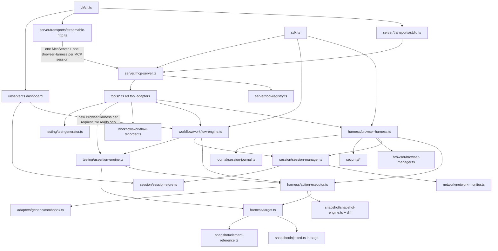
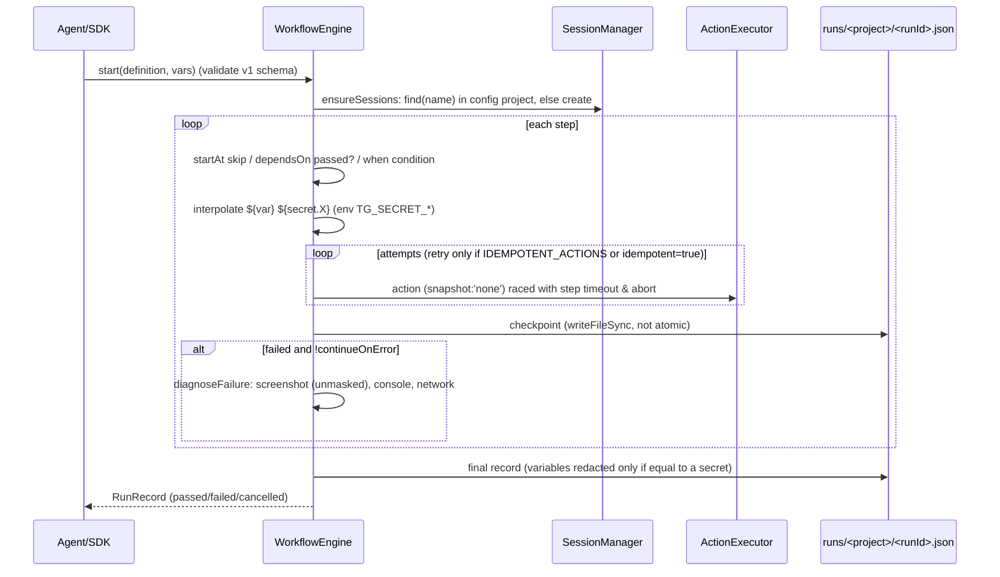

# 02 — Architecture Review (current system)

All line numbers refer to commit `74313fc`.

## 1. Current dependency flow



Observations:

1. **MCP is cleanly separated from browser execution.** `src/harness` imports nothing from `src/server` or `src/tools` (verified with grep). The `ToolContext` passes the harness plus the workflow engine/recorder into tool handlers. ADR-0001 is respected.
2. **The harness works without MCP**, proven by `tests/integration/harness.test.ts` and the SDK examples. Gaps: `HarnessSession` drops the session's project (D8, `browser-harness.ts:122-124`), and many executor capabilities (scroll, drag, upload, tabs, frames, network, traces) are only reachable through `harness.actions` rather than the facade.
3. **Tool adapters are thin**, with three exceptions where business logic leaked into `tools/`:
   - `workflow-tools.ts:201-208` `writeArtifact()` performs file-path policy and writes reports — belongs in a harness-side artifact service.
   - `workflow-tools.ts:224` constructs a new `AssertionEngine` per call (fine functionally, but assertion is a harness capability that should live on the harness).
   - `page-tools.ts` repeats the "has a real target" predicate (`Object.keys(t).some(k => k !== 'exact' && k !== 'nth')`) seven times — a harness concern (`hasTarget`).
4. **No circular dependencies** were found between modules (imports are type-only where they point "up", e.g. `tool-registry.ts` imports types from the harness).
5. **Dashboard couples storage reads to the harness**: `ui/server.ts:326` and `:373` instantiate a full `BrowserHarness` (permission manager, journal, audit logger, browser manager…) per HTTP request just to call `WorkflowEngine.listRuns()/loadDefinition()`. This is the clearest symptom of the missing storage abstraction.

## 2. Responsibility analysis of the key classes

| Module                                        | Lines | Responsibilities today                                                                                                                                                                                                                                                                                | Verdict                                                                                                                                                                                                                                                                                                                                                                                   |
| --------------------------------------------- | ----: | ----------------------------------------------------------------------------------------------------------------------------------------------------------------------------------------------------------------------------------------------------------------------------------------------------- | ----------------------------------------------------------------------------------------------------------------------------------------------------------------------------------------------------------------------------------------------------------------------------------------------------------------------------------------------------------------------------------------- |
| `harness/action-executor.ts` `ActionExecutor` | 1,095 | session/page resolution; lifecycle events; dialog racing; settling; snapshot + diff; error collection; **policy checks** (destructive approval only in `click`); recording hook; 25 public operations (navigation, interaction, inspection, tabs, frames, viewport, screenshots, traces, performance) | **Refactor by responsibility, not by size.** Extract (a) `ActionPipeline` — the `run()/finish()` envelope incl. a per-page lock, verification and policy gate applied to _every_ mutating action; (b) `PageInspector` (text/attributes/aria/element/perf); (c) `ArtifactService` (screenshots, traces, reports, path policy). Interaction methods stay as thin functions on the pipeline. |
| `harness/browser-harness.ts`                  |   181 | composition root + facade                                                                                                                                                                                                                                                                             | **Preserve**; fix project propagation, extend facade                                                                                                                                                                                                                                                                                                                                      |
| `harness/target.ts`                           |   134 | target schema, locator construction, ref/locator resolution, ambiguity, locator suggestion                                                                                                                                                                                                            | **Enhance** (target guard/fingerprint, resolution policy); absorb duplicated `AssertionEngine.locatorFor`                                                                                                                                                                                                                                                                                 |
| `snapshot/injected.ts`                        |   685 | in-page role/name/state/value computation, refs, traversal, framework detection                                                                                                                                                                                                                       | **Preserve & harden** (install via init script, capture built-ins, fingerprint emission, slot fix)                                                                                                                                                                                                                                                                                        |
| `session/session-manager.ts`                  |   572 | session registry, context creation, restore, CDP, page registration, dialogs, **domain-policy routes and redirect enforcement**, video lifecycle                                                                                                                                                      | **Split moderately**: move policy enforcement (`installPolicy`, redirect & committed-URL checks, ≈120 lines) into `security/network-enforcer.ts`; move video finalization into `RecordingManager`. Keep the registry.                                                                                                                                                                     |
| `server/tool-registry.ts`                     |   124 | types, profile selection, output formatting                                                                                                                                                                                                                                                           | **Preserve**                                                                                                                                                                                                                                                                                                                                                                              |
| `server/mcp-server.ts`                        |   257 | McpServer wiring, approval handler, timeouts, audit                                                                                                                                                                                                                                                   | **Enhance**: per-call timeout must not mark interrupted actions retry-safe (D12); audit the _targeted_ session (D20)                                                                                                                                                                                                                                                                      |
| `workflow/workflow-engine.ts`                 |   620 | storage (defs, runs, checkpoints), execution, interpolation, conditions, diagnostics                                                                                                                                                                                                                  | **Split storage out** (`WorkflowRepository`, `RunRepository`); keep executor; fix D9/D13/D14/D16/D19                                                                                                                                                                                                                                                                                      |
| `ui/server.ts`                                |   687 | HTTP server, auth/CSRF, file boundary, config editing, read models for sessions/runs/workflows                                                                                                                                                                                                        | **Preserve** the security envelope; move read models onto repositories (no harness construction)                                                                                                                                                                                                                                                                                          |

## 3. Cross-cutting checks

### 3.1 Security enforcement consistency

| Path                   | Domain policy                    | Destructive approval                                                                      | High-risk approval   | File roots                  | Redaction                                                         |
| ---------------------- | -------------------------------- | ----------------------------------------------------------------------------------------- | -------------------- | --------------------------- | ----------------------------------------------------------------- |
| MCP tools              | ✓ (context routes + tool checks) | click only                                                                                | upload, connect      | ✓                           | ✓                                                                 |
| SDK (`BrowserHarness`) | ✓ (same SessionManager)          | click only; approval handler defaults to **"unavailable" → APPROVAL_REQUIRED** unless set | same                 | ✓                           | ✓                                                                 |
| Workflow engine        | ✓                                | click only; **fill+submit / press / type submit bypass**                                  | n/a (no upload step) | screenshots go to artifacts | step messages masked; **assertion actual values not masked** (D7) |
| Dashboard              | n/a (no browser)                 | n/a                                                                                       | n/a                  | realpath boundary           | `clean()` scrubbing                                               |

Conclusion: enforcement points exist but are **per-method**, so every new action path must remember to call them. V2 must move policy into a single action pipeline (doc 14).

### 3.2 Session and page isolation

- Browser contexts isolate cookies/storage per session (verified).
- HTTP transport isolates harnesses per MCP session but **shares `dataDir`/`project`**: saved sessions, workflows, runs and audit are visible to every client holding the single bearer token. Acceptable for single-tenant use; must be documented and not presented as multi-tenant isolation.
- Workflows bind steps to sessions **by name in the configured project** and reuse an existing session with that name (`workflow-engine.ts:349-361`), so a run can drive the same pages an interactive agent is using (D16).

### 3.3 Concurrency

There is **no serialization** of operations per page or session:

- `ActionExecutor.run()` (`action-executor.ts:199-272`) and `snapshot()` (`:745-777`) execute concurrently if two calls arrive (HTTP clients, a background `workflow_execute` + interactive tools, SDK callers).
- `collectFrame()` reads `refs.nextIndex` before the in-page collect and writes it after (`snapshot-engine.ts:93-95`). Two overlapping snapshots that discover new elements can both hand out the same `eN`; the page-side `refFor()` (`injected.ts:435-443`) then rebinds `eN` to the second element, so a ref returned by the first snapshot targets a different node. (Code-evident; not reproduced deterministically.)
- `SessionManager.create()` checks for an existing name, then awaits browser/context creation (`session-manager.ts:156-208`); concurrent creates with the same name both proceed and one context leaks (D25).
- Tool and step timeouts race the action promise but **do not cancel it** (`mcp-server.ts:36-49`, `workflow-engine.ts:603-620`); the action keeps running while the caller is told "Retry safe: yes" (D12).
- Multiple MCP processes (e.g. Claude Code and Cursor both configured) share `~/.tg-browser`; JSON writes are non-atomic and unlocked (D9).

Lifecycles that are currently conflated and must be distinguished in V2:

| Lifecycle                 | Current owner                                                            | Lifetime                                 |
| ------------------------- | ------------------------------------------------------------------------ | ---------------------------------------- |
| MCP transport session     | `streamable-http.ts` map / STDIO process                                 | client connection                        |
| Browser session (context) | `SessionManager`                                                         | until closed / process exit              |
| Page (tab)                | `Session.pages`                                                          | until closed / crash (crash only logged) |
| Workflow run              | `WorkflowEngine.runs` (in memory, 10 min after finish) + checkpoint file | run duration                             |
| AI conversation           | not modelled (cannot be — the server never sees it)                      | client-side                              |

### 3.4 Storage abstraction

None. `fs` is called directly from `WorkflowEngine`, `SessionStore`, `SessionJournal`, `AuditLogger`, `ActionExecutor` (screenshots/traces), `workflow-tools.ts` (reports), `SessionManager` (videos) and `ui/server.ts`. See doc 05.

### 3.5 Can Browser Intelligence be added without rewriting the core?

Yes, **if** three seams are introduced first: (1) a single action pipeline with a per-page lock where target resolution, policy and verification hooks run for every action; (2) an observation hook after each snapshot (the place memory subscribes to — `captureSnapshot` already returns structured `RawNode[]`); (3) repository interfaces. The snapshot engine, ref registry, session manager and workflow executor can all be kept.

## 4. Current lifecycles

### 4.1 Browser action lifecycle

```mermaid
sequenceDiagram
  participant C as MCP client
  participant S as mcp-server (withTimeout)
  participant T as tool adapter
  participant X as ActionExecutor.run
  participant R as resolveTarget / RefRegistry
  participant P as Playwright
  C->>S: tools/call browser_click {ref}
  S->>S: Zod parse, start timer (timeoutMs)
  S->>T: handler(args)
  T->>X: click(target, opts, ctx)
  X->>X: sessionFor(name) → default project only; ensurePage
  X->>X: emit action.started; reject if dialog pending
  X->>R: resolve(ref): docId match, element connected, role equal (name NOT checked)
  R-->>X: ElementHandle + desc (desc computed by page-world __tgSnap)
  X->>X: isDestructiveName(desc.name)? → approval (click only)
  X->>P: el.click() raced against page 'dialog'
  P-->>X: dispatched
  X->>X: settle ≤2s (pending xhr/fetch/doc/script) + 60ms
  X->>X: captureSnapshot → diff vs lastSnapshot (same docId)
  X->>X: collect console/network errors since startSeq
  X-->>T: ActionResult{success:true, pageState, errors?}
  T-->>C: "✓ Clicked …" + diff + "Errors during action"
  Note over S: if timer fires first → ACTION_TIMEOUT, retryable:true,<br/>but the click keeps running
```

### 4.2 Workflow execution lifecycle



### 4.3 Session lifecycle

```mermaid
stateDiagram-v2
  [*] --> Creating: create(name, project) / ensureActive('default')
  Creating --> Active: context + policy routes + monitor + first page
  Creating --> Active: restore → decrypt state → storageState
  Active --> Active: pages opened/closed, dialogs, navigations
  Active --> Saved: save() → AES-GCM state file + meta (meta not atomic)
  Saved --> Active
  Active --> Closed: close() / context 'close' / browser disconnected
  Active --> Degraded: page 'crash' (only logged; PageState stays registered)
  Closed --> [*]: videos finalized
```



## 5. Module verdicts

| Action          | Modules                                                                                                                                                                                                                                                                                 |
| --------------- | --------------------------------------------------------------------------------------------------------------------------------------------------------------------------------------------------------------------------------------------------------------------------------------- |
| Preserve        | `browser/*`, `network/*`, `security/data-redactor.ts`, `security/audit-logger.ts`, `server/tool-registry.ts`, `server/transports/*`, `snapshot/snapshot-diff.ts`, `journal/*`, `testing/report-generator.ts`, dashboard security envelope                                               |
| Enhance         | `snapshot/injected.ts`, `snapshot/element-reference.ts`, `harness/target.ts`, `testing/assertion-engine.ts` (→ verification), `adapters/generic/combobox.ts`, `security/domain-policy.ts`, `security/permission-manager.ts`, `testing/test-generator.ts`, `workflow/workflow-schema.ts` |
| Refactor        | `harness/action-executor.ts` (pipeline + inspector + artifact service), `workflow/workflow-engine.ts` (storage out), `session/session-manager.ts` (policy enforcer out), `ui/server.ts` read models                                                                                     |
| Merge           | `AssertionEngine.locatorFor` into `target.ts`; journal/dashboard secret scrubbing into `DataRedactor.scrubKnownSecrets()`                                                                                                                                                               |
| New (justified) | `harness/action-pipeline.ts` (lock, policy, verification), `storage/*` (repositories + SQLite adapter), `memory/*` (observation, fingerprints, reconciliation), `workflow/impact-analyzer.ts`                                                                                           |
