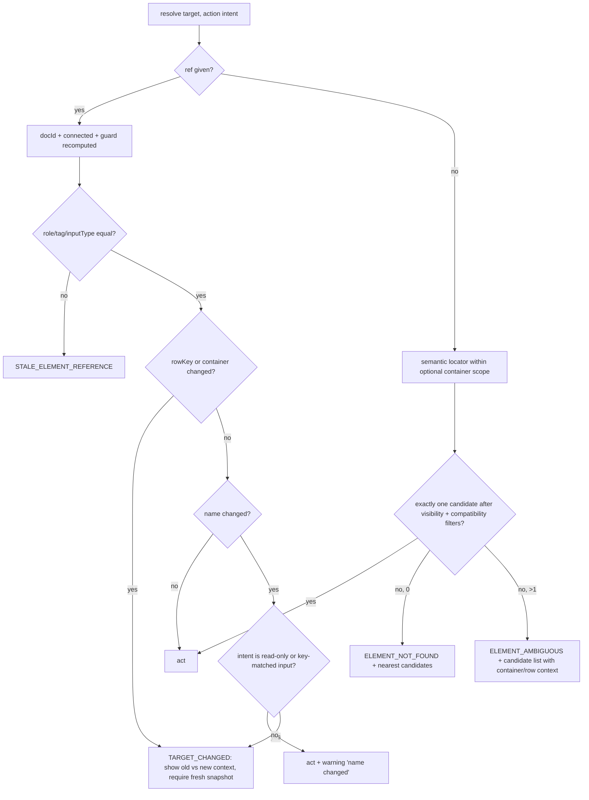

# 03 — Element Recognition and DOM Accuracy

## 1. How the current system works (verified in code)

| #   | Question             | Current implementation                                                                                                                                                                                                                                                                                                                                                                                                                                                                                                                  |
| --- | -------------------- | --------------------------------------------------------------------------------------------------------------------------------------------------------------------------------------------------------------------------------------------------------------------------------------------------------------------------------------------------------------------------------------------------------------------------------------------------------------------------------------------------------------------------------------- |
| 1   | Injection            | `installScriptSource()` serializes `tgInstall` with a `__name` shim (`injected.ts:678-681`); `ensureInstalled()` evaluates it via `frame.evaluate` before **every** collect (`snapshot-engine.ts:79-81`). It runs in the **page's main world**; idempotency guard is `window.__tgSnap.version === 1` (`injected.ts:61`).                                                                                                                                                                                                                |
| 2   | Traversal            | Recursive `walk()`/`walkChildren()` from `document.body` (or the scope element) over element children, open `shadowRoot` children and `slot.assignedNodes({flatten:true})` (`injected.ts:472-576`). Skips script/style/template/head, `aria-hidden="true"`, `inert`, `display:none`, closed `<dialog>`, closed `<details>` (summary only). `visibility:hidden` elements lose their role but children are still walked. Node cap `maxNodes` 4000 (`snapshot-engine.ts:161`); depth cap `maxDepth` 40; iframe recursion depth 3 (`:169`). |
| 3   | Roles                | `implicitRole()` (`injected.ts:166-270`): first token of explicit `role` (no fallback validation; `presentation/none` → none), HTML-AAM subset for tags/input types, contenteditable → textbox, otherwise none. A `cursor:pointer` heuristic adds `clickable` (`:445-450`, `:521`). Roles outside `KEEP_ROLES` are dropped; unnamed `group/form/figure/article` are flattened (`:523-526`).                                                                                                                                             |
| 4   | Accessible names     | `accName()` (`:298-347`): `aria-labelledby` (one level, `innerText`), `aria-label`, button value / image alt, `input.labels`, `title`, `placeholder`, `legend`/`caption`/`figcaption`, iframe title/name, name-from-content for a role subset (blocked when an interactive descendant exists, except for buttons/links/options/tabs/switches). A simplified accname algorithm — no recursion into embedded controls, no `aria-describedby`, no CSS pseudo content.                                                                      |
| 5   | Interactive elements | `INTERACTIVE` set (`:63-83`) + `clickable` heuristic. `filterInteractive()` (`snapshot-engine.ts:189-201`) keeps interactive + orientation roles.                                                                                                                                                                                                                                                                                                                                                                                       |
| 6   | Ref assignment       | `refFor()` (`injected.ts:435-443`): `WeakMap<Element,string>` gives an element its existing ref; otherwise `e${counter}` from a **Node-side** counter `RefRegistry.nextIndex`, stored in a page-side `Map<string,Element>`.                                                                                                                                                                                                                                                                                                             |
| 7   | DOM identity storage | Page side: `st.map` (ref→Element), `st.ids` (Element→ref), `st.docId` (random per install). Node side: `RefRegistry` `Map<ref, {frame, docId, role, name, snapshotId}>` (`element-reference.ts:5-31`), capped at 50k entries.                                                                                                                                                                                                                                                                                                           |
| 8   | Ref → ElementHandle  | `RefRegistry.resolve()` (`element-reference.ts:45-118`): ref format → entry → frame not detached → `evaluateHandle` checks `__tgSnap.docId === entry.docId`, element still connected → **role must equal the recorded role** (name may change by design, `:103-104`).                                                                                                                                                                                                                                                                   |
| 9   | Semantic locators    | `buildLocator()` (`target.ts:48-72`): role(+name, exact by default) > label > testId > placeholder > text > CSS (XPath refused); `nth`; on `count>1` it narrows to the single visible match, else `ELEMENT_AMBIGUOUS` (`target.ts:94-104`). `suggestLocator()` (`:117-134`) produces recorder/test locators.                                                                                                                                                                                                                            |
| 10  | Stale refs           | Unknown ref below `nextIndex` → `STALE_ELEMENT_REFERENCE`; docId mismatch / disconnected / role change → stale.                                                                                                                                                                                                                                                                                                                                                                                                                         |
| 11  | Duplicates           | Refs disambiguate duplicates naturally. Semantic locators: visible-only narrowing, otherwise error. No context (form/row/dialog) scoping in `Target`.                                                                                                                                                                                                                                                                                                                                                                                   |
| 12  | iframes / Shadow DOM | Child frames are collected separately and spliced under the iframe node via `frameElement()` + `refOf()` (`snapshot-engine.ts:105-131`); refs carry their `Frame`. Open shadow roots and slots are traversed; **closed shadow roots are invisible**.                                                                                                                                                                                                                                                                                    |
| 13  | Dynamic rendering    | Snapshot after settle (≤2 s); diff by ref; a retry after `domcontentloaded` if collection throws (`snapshot-engine.ts:170-174`). Errors inside `collectFrame` are swallowed (`:133-135`) → silently empty frames.                                                                                                                                                                                                                                                                                                                       |
| 14  | Compact output       | Line format `role "name" [states] [ref=eN]: "value"`, paginated by `maxChars` (`snapshot-engine.ts:228-257`); diff lists top-most added/removed and changed name/value/states (`snapshot-diff.ts:66-119`).                                                                                                                                                                                                                                                                                                                              |

## 2. Failure scenarios

| Scenario                                                            | Current behaviour                                                                                                                                                                                                         | Risk                                                                               |
| ------------------------------------------------------------------- | ------------------------------------------------------------------------------------------------------------------------------------------------------------------------------------------------------------------------- | ---------------------------------------------------------------------------------- |
| Two buttons, same name (different rows/cards)                       | Refs distinct ✓. `role+name` → `ELEMENT_AMBIGUOUS` unless exactly one is visible. **Recorder/test generator emit `getByRole(name)` with no container**, so replay is ambiguous or picks the visible one                   | Medium (replay)                                                                    |
| Same label in two forms                                             | Refs ✓; `label=` ambiguous; recorder emits `getByLabel` only                                                                                                                                                              | Medium                                                                             |
| Dynamic dialogs                                                     | Diff reports `dialog [modal]` ✓; refs inside work                                                                                                                                                                         | Low                                                                                |
| Angular CDK overlays                                                | Overlay container at `<body>` level is walked; combobox adapter searches page-wide when no `aria-controls`                                                                                                                | Medium: page-wide option lookup can hit another open overlay; untested on real CDK |
| Virtual scrolling / row recycling                                   | **Same node keeps its ref while its business meaning changes**                                                                                                                                                            | **High — D1, reproduced**                                                          |
| Reordered rows (nodes moved, not recycled)                          | Refs follow nodes ✓ (correct)                                                                                                                                                                                             | Low                                                                                |
| DOM node reuse after re-render (framework keeps node, changes text) | Same as D1                                                                                                                                                                                                                | High                                                                               |
| Reactive form changes (label/required toggles)                      | Ref stays; name change tolerated; required shown in states                                                                                                                                                                | Low for refs; Medium for memory                                                    |
| Angular Signals / Signal Forms                                      | Nothing framework-specific; works to the extent DOM/ARIA reflects state (unverified, no fixture)                                                                                                                          | Unknown                                                                            |
| Hidden / disabled                                                   | Hidden skipped (display/visibility/aria-hidden/inert). Not detected: `opacity:0`, zero-size, off-screen, clipped, covered by overlay. Disabled shown as state; actions on disabled wait for the Playwright timeout (30 s) | Medium                                                                             |
| Lazy components                                                     | Not in snapshot until rendered; semantic locators wait up to timeout                                                                                                                                                      | Low                                                                                |
| Iframe navigation                                                   | Child frame snapshot re-collected; old refs of that frame become stale via docId ✓                                                                                                                                        | Low                                                                                |
| Open Shadow DOM with slots                                          | **Slotted light-DOM children emitted twice with the same ref** (`injected.ts:476-479`: shadow children _and_ light children are both walked for a host)                                                                   | Medium — D10, reproduced                                                           |
| Closed Shadow DOM                                                   | Invisible to snapshot and to Playwright locators                                                                                                                                                                          | Limitation (document it)                                                           |
| Semantic meaning changes, DOM identity/role same                    | Not detected (role-only check)                                                                                                                                                                                            | **High** (D1 generalization)                                                       |
| Page script tampering                                               | Page can pre-define `window.__tgSnap` (version 1) → controls names, refs and `describe()` used for approval                                                                                                               | **Medium-High — D5, reproduced**                                                   |
| Concurrent snapshots                                                | Node-side counter race can rebind refs                                                                                                                                                                                    | Medium — D15                                                                       |
| Truncated snapshots (node cap)                                      | Elements beyond the cap missing; a later diff against a full snapshot reports them as "Added", and vice versa "Removed"                                                                                                   | Low for actions, **High for memory** (false removals)                              |

## 3. Critical scenario: recycled row REQ001 → REQ009

Code path: `RefRegistry.resolve('e15')` finds the entry, the frame is attached, `docId` matches, `st.map.get('e15')` returns the **same connected node**, `describe()` returns role `button` = recorded role → the handle is returned and clicked. The recorded `name` is not compared, and even if it were, both rows say "Approve". **Yes, the current implementation executes the action against REQ009.** Probe P1 confirmed it: `click ref=e5` succeeded and the page logged `approved REQ009`.

### 3.1 Regression test design (fixture-based)

Add `/virtual-table` to `tests/fixtures/app/server.mjs`: a 10-row window over 100 records where scrolling **rewrites the text of existing `<tr>` nodes** (as CDK virtual scroll does), plus an "Approve" button per row whose handler logs the row key.

```ts
it('refuses a ref whose row context changed (virtual-scroll recycling)', async () => {
  await s.navigate(`${base}/virtual-table`);
  const snap = await s.snapshot();
  const ref = refOf(snap.text, /row "REQ001.*?button "Approve" \[ref=(e\d+)\]/s);
  await s.scroll({ target: { testId: 'viewport' }, direction: 'down', amount: 400 }); // node now shows REQ009
  await expect(s.click({ ref })).rejects.toMatchObject({ code: 'TARGET_CHANGED' });
  expect(await logText()).toBe('none'); // nothing approved
});
it('still accepts the ref when only volatile text changed (counter, timestamp)', …);
it('accepts the ref after reorder when the row key moved with the node', …);
it('refuses when the button label changed (Approve → Reject) for non-read actions', …);
```

Negative/positive pairs are required so the guard does not regress live counters (the reason name changes were tolerated).

## 4. Identity model

Four identities must not be conflated:

| Identity                        | Scope                  | Source                                                                                                          | Lifetime                                     | Used for                                              |
| ------------------------------- | ---------------------- | --------------------------------------------------------------------------------------------------------------- | -------------------------------------------- | ----------------------------------------------------- |
| **Runtime DOM identity**        | one document           | `WeakMap<Element>` → `eN`                                                                                       | until node removed / document replaced       | acting within the current snapshot                    |
| **Stable element identity**     | page (route + variant) | stable keys: `data-testid`, `formcontrolname`, `name`, stable-looking `id`, role + label within named container | across reloads and builds while keys persist | memory, workflow replay, healing                      |
| **Business entity identity**    | data row / record      | row key (row header cell, first cell, `aria-rowindex` + key column, `data-row-key`, record id in link `href`)   | data-dependent                               | guarding actions in tables/lists; workflow parameters |
| **Persistent locator identity** | workflow step / test   | ordered locator candidates (`getByTestId`, `getByRole` scoped to container, `getByLabel` in form)               | until UI change                              | replay and generated tests                            |

The current code only has the first.

## 5. Element fingerprint — necessary, but small

An in-memory fingerprint captured at snapshot time is **necessary** to fix D1 and costs little: the walker already computes role, name, states and value. Persistent fingerprints are only needed later for memory (doc 06).

Properties and their reliability:

| Property                                                                       | Reliability                                                                                                     | Use                                                              |
| ------------------------------------------------------------------------------ | --------------------------------------------------------------------------------------------------------------- | ---------------------------------------------------------------- |
| role                                                                           | high (structural)                                                                                               | hard equality                                                    |
| tag + input type                                                               | high                                                                                                            | hard equality (textbox→combobox is incompatible)                 |
| `data-testid` / `data-test(-id)`                                               | high _when present_; can be deliberately changed                                                                | strong key                                                       |
| `formcontrolname`, `name` attribute                                            | high in Angular reactive forms                                                                                  | strong key                                                       |
| `id`                                                                           | medium: frameworks generate ids (`mat-input-12`, `cdk-overlay-3`) — use only if not matching generated patterns | strong key if "stable-looking"                                   |
| accessible name                                                                | medium: i18n, dynamic counts                                                                                    | hard for **mutating** actions in-document; fuzzy across versions |
| container context (nearest named form/dialog/region/landmark, fieldset legend) | medium-high                                                                                                     | disambiguation                                                   |
| row key (business entity)                                                      | high for table actions **when detectable**                                                                      | hard equality for row-scoped actions                             |
| frame URL origin + path, document id                                           | high                                                                                                            | scope                                                            |
| structural position (index among same-role siblings)                           | low (reorders, conditionals)                                                                                    | tie-breaker only, never sole proof                               |
| states (required/disabled/readonly)                                            | volatile                                                                                                        | compatibility signal, not identity                               |
| value                                                                          | volatile + sensitive                                                                                            | **never** part of identity; never persisted                      |

### 5.1 Runtime guard (fixes D1)

At collect time the walker emits, per ref, a compact guard (not shown to the model):

```ts
interface RefGuard {
  role: string;
  tag: string;
  inputType?: string;
  name: string; // normalized accessible name
  keys: { testId?: string; formControl?: string; nameAttr?: string; id?: string };
  container?: string; // role + name of nearest named form/dialog/region/row
  rowKey?: string; // text of row header / first cell / data-row-key (max 80 chars)
}
```

`RefRegistry` stores it with the entry. `resolve(ref, intent)` recomputes it for the live node and applies the policy below.

### 5.2 Safe resolution strategy



Hard rules: never pick "first match" for a mutating action; never accept a different business key; ambiguity is an error, not a coin toss. `nth` remains allowed only when the caller supplies it explicitly (and the recorder should prefer container scoping over `nth`).

`Target` gains an optional `within: { ref? | role+name? | rowKey? }` so the model and the recorder can address "Approve in row REQ001" deterministically, and the generator can emit `page.getByRole('row', { name: /REQ001/ }).getByRole('button', { name: 'Approve' })`.

## 6. Other recommended snapshot fixes

1. **Slot duplication (D10):** for a shadow host, walk only `shadowRoot.childNodes` (light children are reached through slots); walk light children only when the host has no shadow root.
2. **Tampering (D5):** install the engine with `context.addInitScript()` so it exists before page scripts; keep state in a closure; define `window.__tgSnap` non-writable/non-configurable; capture `Map`, `WeakMap`, `getComputedStyle`, `Element.prototype` getters at install time. Additionally compute the name used for **approval classification** from Playwright's isolated-world APIs (`locator.ariaSnapshot()` / `elementHandle.innerText()` / `getAttribute`) and treat a mismatch with the snapshot name as `TARGET_CHANGED`. Residual risk (a page can always lie about its own labels) remains documented.
3. **Ref allocation race (D15):** allocate refs inside the per-page lock (doc 14) or move the counter into the page and namespace refs per frame (`f1e12`).
4. **Swallowed frame errors:** report `frame unavailable` nodes instead of silently returning `undefined` (`snapshot-engine.ts:133-135`).
5. **Visibility:** add zero-size/`opacity:0`/`content-visibility` checks for interactive candidates; mark `[offscreen]` rather than hiding.
6. **Closed shadow DOM:** document as unsupported; do not attempt CDP piercing in V2.
7. **Truncation metadata:** snapshots must carry `complete: boolean` (node cap, depth cap, pagination, frames skipped) — required by memory to avoid false "removed" classifications (doc 07).
