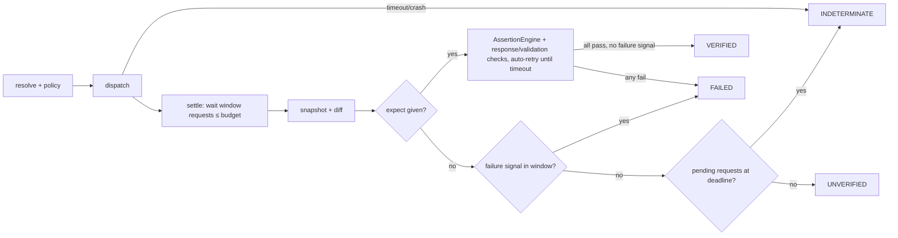

# 04 — Action Verification

## 1. How success is decided today

`ActionExecutor.run()` (`action-executor.ts:199-272`) resolves the target, performs the Playwright call raced against a `dialog` event, then `finish()` (`:139-193`) settles, snapshots, diffs and collects errors. The result type hard-codes `success: true` (`:38`, `:151`); failures are thrown. `formatAction()` (`tool-registry.ts:93-111`) always prints `✓ …` and appends "Errors during action" when the network monitor saw 4xx/5xx or console errors.

| Stage                     | Distinguished today?                                                                                                                              | Where                         |
| ------------------------- | ------------------------------------------------------------------------------------------------------------------------------------------------- | ----------------------------- |
| Action dispatched         | implicitly (Playwright call resolved)                                                                                                             | `el.click()` etc.             |
| Browser action completed  | partly: settle waits ≤2 s for xhr/fetch/document/script started after the action (`:120-137`); requests still pending at 2 s are **not reported** | `settle()`                    |
| UI state changed          | diff is returned, but not interpreted ("No visible changes." is still `✓`)                                                                        | `finish()`                    |
| Network request completed | failures listed (≥400 or failed)                                                                                                                  | `monitor.errors(…, startSeq)` |
| Business result verified  | **no** (only via a separate `test_assert` call or workflow `assert` step)                                                                         | —                             |

Probe P4 (fixture `/api-failure`, HTTP 500): `success: true`, text `✓ Clicked button "Load data" … Errors during action: … → 500`. A model skimming the first line, or any SDK consumer checking `success`, concludes the action worked.

Related defects:

- **D12** Tool timeout (`mcp-server.ts:36-49`) and workflow step timeout (`workflow-engine.ts:603-620`) reject with `ACTION_TIMEOUT, retryable: true` while the Playwright action continues. For a submit this is the worst possible combination: the model is told retry is safe while the first submit may still land.
- **D13** `fill` is in `IDEMPOTENT_ACTIONS` (`workflow-schema.ts:29-42`) but `fill` with `submit: true` presses Enter (`action-executor.ts:509`; `workflow-engine.ts:385`) → retried.
- Dialog race: when a dialog wins (`:237-240`), the result says "triggered a dialog"; the underlying action promise may later reject or resolve unobserved. Acceptable, but the outcome must be `INDETERMINATE` until the dialog is handled.
- `no_console_errors` / `no_failed_requests` assertions consider the whole page history, not the action window (`assertion-engine.ts:108-123`).

## 2. Existing building blocks to reuse

| Building block                                     | Reuse                                                                                                             |
| -------------------------------------------------- | ----------------------------------------------------------------------------------------------------------------- |
| `NetworkMonitor` sequence numbers (`startSeq`)     | action window for network evidence                                                                                |
| `settle()`                                         | becomes "completion detection" and reports still-pending requests                                                 |
| `diffSnapshots()`                                  | UI-change evidence (`changed status "Draft" → "Pending Approval"`)                                                |
| `AssertionEngine` (auto-retrying web-first checks) | the verification evaluator — already supports text/value/url/title/visible/hidden/enabled/checked/attribute/count |
| Workflow `assert` steps                            | become step-level `expect`                                                                                        |
| `TgError.retryable`                                | replaced for actions by an explicit idempotency × dispatch-state rule                                             |

No new engine is required; the work is a **result contract** and a small verifier composed from these pieces.

## 3. Proposed result contract

```ts
type VerificationStatus = 'VERIFIED' | 'FAILED' | 'UNVERIFIED' | 'INDETERMINATE';
type DispatchState = 'not_started' | 'dispatched' | 'completed' | 'unknown'; // unknown = timeout/crash mid-action

interface ActionOutcome {
  actionExecuted: DispatchState;
  verificationStatus: VerificationStatus;
  expected?: ExpectSpec[]; // what the caller asked to verify
  observed: {
    urlChanged?: { from: string; to: string };
    uiChanges: number; // diff size
    network: {
      completed: number;
      failed: Array<{ method: string; url: string; status: number | null }>;
      pending: number;
    };
    consoleErrors: number;
    dialog?: { type: string; message: string };
  };
  evidence: Array<{ kind: 'assertion' | 'network' | 'diff' | 'dialog'; passed: boolean; detail: string }>;
  retryable: boolean; // computed, see §5
  warnings: string[];
  failureReason?: string;
}
// ActionResult keeps success:true (= no exception, dispatched) for backward compatibility and gains `outcome`.
```

Status semantics:

| Status          | Meaning                                                                                                                                                                                                               |
| --------------- | --------------------------------------------------------------------------------------------------------------------------------------------------------------------------------------------------------------------- |
| `VERIFIED`      | every `expect` passed within its timeout, and no failure signal in the action window                                                                                                                                  |
| `FAILED`        | an `expect` failed, **or** a failure signal occurred (≥400 / failed request initiated in the window, `aria-invalid` appeared on the target form, an `alert` role with error text appeared — signals are configurable) |
| `UNVERIFIED`    | no `expect` given and no failure signal (today's default)                                                                                                                                                             |
| `INDETERMINATE` | dispatch state `unknown` (timeout/crash/disconnect), requests still pending at settle deadline, or a dialog interrupted the action                                                                                    |

Text output changes only the first symbol: `✓` VERIFIED, `•` UNVERIFIED, `✗` FAILED, `?` INDETERMINATE, followed by a one-line reason. JSON/`verbose` output carries the full `outcome`.

## 4. Expectation specs (reusing `AssertionSchema`)

```ts
type ExpectSpec =
  | Assertion // existing: text, value, url, title, visible, hidden, enabled, disabled, checked, attribute, count
  | {
      type: 'response';
      urlPattern: string;
      method?: string;
      status?: number | number[];
      json?: Array<{ path: string; equals?: string | number | boolean; matches?: string }>;
      timeout?: number;
    }
  | { type: 'validation'; target?: Target; outcome: 'valid' | 'invalid'; message?: string }
  | { type: 'no_new_errors' }; // scoped to the action window
```

- `response` matches requests **started in the action window**. Body access is on-demand and in memory only (never logged/persisted, redacted in evidence); it does not require turning on global `captureBodies`.
- "Business status" (`json: [{ path: 'status', equals: 'PENDING_APPROVAL' }]`) or UI text expectations express business success. **HTTP 200 alone never yields `VERIFIED`** unless the caller explicitly asked only for `status: 200`.
- `validation` reads `aria-invalid`, `:user-invalid`, `aria-errormessage`/`aria-describedby` text inside the target's form.

Surface: add an optional `expect` array to mutating tools (`browser_click`, `browser_fill`, `browser_press_key`, `browser_select_option`, `browser_check`) and to workflow steps (`expect` in V2 schema, doc 10). One shared Zod shape — schema growth ≈ 1–1.5 KB per profile (measure before merging; doc 12).

## 5. Retry rules (idempotency classes)

| Class              | Examples                                                                                                                                            | Auto-retry?                              |
| ------------------ | --------------------------------------------------------------------------------------------------------------------------------------------------- | ---------------------------------------- |
| `read`             | snapshot, get_text, assert, wait                                                                                                                    | yes                                      |
| `idempotent-input` | fill (no submit), select on native select, check/uncheck to a target state, hover, navigate GET                                                     | yes, after verifying preconditions again |
| `non-idempotent`   | click, double_click, press Enter/Space, fill+submit, type+submit, drag, upload, dialog accept, custom combobox selection that triggers server calls | **never** automatically                  |
| `high-impact`      | names matching destructive/business patterns (submit, approve, reject, delete, pay, transfer…) — configurable per project                           | never; approval policy applies           |

`retryable` in the outcome = class allows retry **and** `actionExecuted ∈ {not_started}` or (class is idempotent and state is not `unknown`). A timeout on a non-idempotent action returns `INDETERMINATE` + `retryable: false` + guidance: "Re-snapshot and check whether the submission happened before acting again."

Workflow engine: derive the class from action **and inputs** (`fill` + `submit` → non-idempotent), replacing the static `IDEMPOTENT_ACTIONS` set.

## 6. Timeouts that do not lie (fix for D12)

1. Pass Playwright-level timeouts strictly below the tool budget (`min(tool.timeoutMs − settle − snapshot margin, browser.timeout)`), so the outer timer is a last resort.
2. When the outer timer fires: mark the page **busy** (per-page lock, doc 14) until the inner promise settles; subsequent actions on that page get `PAGE_BUSY` instead of overlapping; return `INDETERMINATE`.
3. Workflow cancellation: abort between steps (today) **and** close the step's pending dialog/stop navigation where possible; record `cancelled-during-step` with dispatch state `unknown`.

## 7. Verification flow



## 8. Tests required

- Click → backend 500 → `FAILED` (no expect) and `✗` prefix (P4 inverted).
- Click → 200 but body `{status:"REJECTED"}` with `expect.response.json status=APPROVED` → `FAILED`.
- Click → 200 and UI text "Pending Approval" with `expect.text` → `VERIFIED`.
- Slow API (3 s) → `INDETERMINATE` with `pending: 1`.
- Non-idempotent timeout → `INDETERMINATE`, `retryable:false`, page busy until inner action settles; second click returns `PAGE_BUSY`.
- Workflow `fill`+`submit` with `retry.attempts: 2` and a failing assertion → exactly one Enter dispatched (server-side counter in fixture).
