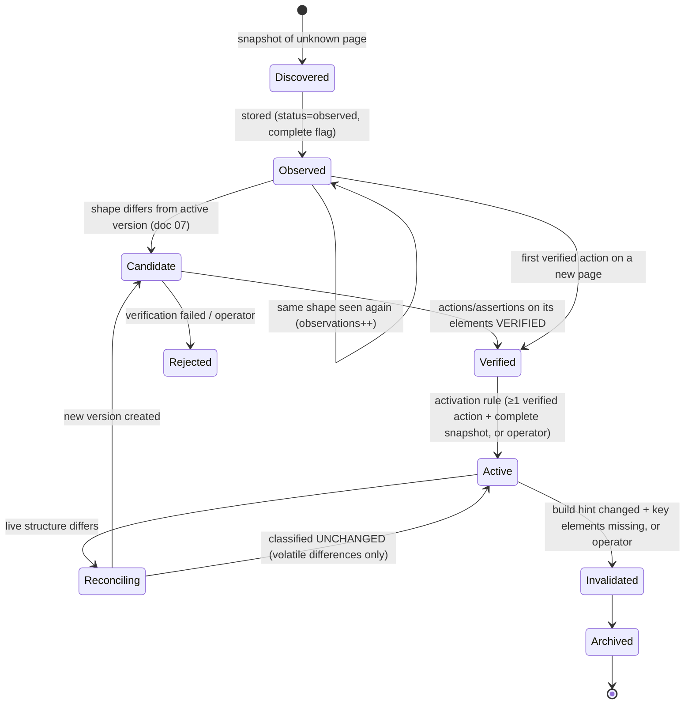

# 06 — Smart Browser Memory

## 1. Feasibility verdict

**Feasible, with a narrower value proposition than proposed.** The snapshot engine already produces structured `RawNode[]` with roles, names, states and refs per frame (`snapshot-engine.ts:150-187`), which is exactly the input memory needs. What it lacks is stable keys (test id, `formcontrolname`, `name` attribute, container, row key) in the emitted data — a small addition to `injected.ts` (doc 03 §5).

Where memory pays off (in order of evidence):

1. **Workflow robustness and change detection** — knowing that the "Request Type" combobox of `/request/create` existed with `formcontrolname=type` in the last verified version lets replay detect a renamed label instead of failing with `ELEMENT_NOT_FOUND`, and lets impact analysis flag affected workflows (doc 07, 10).
2. **Cold-start context for a new AI conversation** — a short "known page" summary (purpose-free, structural) is cheaper than exploring; benefit must be measured (doc 12) because the model still needs a live snapshot to get refs.
3. **Token savings in interactive use** — _weakest_. Refs are runtime identities; memory cannot replace the live snapshot for acting. Diffs and pagination already capture most savings (benchmark: 27k vs 190k chars).

## 2. Principles (non-negotiable)

1. **Memory is a hint; live DOM is the source of truth.** No action is ever executed from memory alone; memory proposes targets, the live resolver (doc 03 §5.2) decides.
2. **Observed ≠ verified.** An element seen in a snapshot is _observed_. It becomes _verified_ only when an action on it completed **and** its outcome was `VERIFIED` (doc 04), or an explicit assertion targeted it.
3. **Memory content is untrusted.** Names and labels come from web pages. They are stored length-limited, control-character-stripped, rendered as quoted data, never inserted into server instructions or tool descriptions.
4. **No values.** Never store field values, typed input, credentials, cookies, tokens, table cell data or free text. Store the _shape_ of a page, not its content.
5. **Isolation by scope** = `(project, origin, environment, auth_context)`. `auth_context` is a caller-declared label (e.g. `maker`, `checker`), never derived from cookies or tokens. No cross-scope reads.
6. **Authorization is never remembered.** Approvals are not cached in memory; replaying a previously approved destructive action requires a new approval.

## 3. What to remember (MVP cut)

| Layer       | Remember                                                                                                                                                                 | MVP?          | Explicitly not stored                                                                          |
| ----------- | ------------------------------------------------------------------------------------------------------------------------------------------------------------------------ | ------------- | ---------------------------------------------------------------------------------------------- |
| Application | scope row: origin, environment, framework hint (`ng-version` etc.), optional build hint                                                                                  | yes           | user names, tenant data                                                                        |
| Page        | route key (`/requests/:id`), page key (route + primary heading/landmarks signature), variant key, shape/label hashes, completeness flag, first/last seen, active version | yes           | titles containing record data (normalize digits/ids)                                           |
| Element     | memory id, semantic key, role, fingerprint (role, tag, inputType, keys, container, normalized name ≤ 200), locator candidates, verification timestamp                    | yes           | values, `placeholder` examples containing data (heuristic: drop if contains digits ≥ 4 or `@`) |
| Action      | last verified action kind per element + expectation that verified it                                                                                                     | V2.1          | the input values                                                                               |
| Workflow    | dependencies (derived from definitions)                                                                                                                                  | yes (derived) |                                                                                                |
| Failure     | failure codes per element/page version (`STALE`, `AMBIGUOUS`, `INCOMPATIBLE`), and which recovery _was verified_                                                         | V2.1          | screenshots, page text                                                                         |

Table rows, list items, options of large lists, and text nodes are **not** remembered as elements; tables are remembered by their column headers only.

## 4. Lifecycle



Discover → Observe → Validate → Remember → Verify → Reconcile → Adapt → Invalidate → Archive map onto these states; "Adapt" means _proposing_ updated mappings (doc 08), not changing workflows.

## 5. Start modes

| Mode     | Trigger                               | Behaviour                                                        | Response to the model                                                                                                                 |
| -------- | ------------------------------------- | ---------------------------------------------------------------- | ------------------------------------------------------------------------------------------------------------------------------------- |
| Cold     | no page row for `(scope, page_key)`   | normal snapshot; store observation if snapshot complete          | unchanged (snapshot) + `Memory: new page recorded (observed)`                                                                         |
| Warm     | active version and `shape_hash` equal | normal snapshot (refs are needed); validate key elements present | snapshot (or diff) + `Memory: matches verified version v3 (2026-11-20)`; optional `interactiveOnly` suggestion when the page is known |
| Adaptive | active version exists, hash differs   | snapshot; run reconciliation (doc 07); create candidate version  | snapshot + compact change list: `Memory: 3 changed, 2 added, 1 unobserved since v3; affects workflows: create-request (NEEDS_INPUT)`  |

The model never receives _only_ memory. Every response that enables an action includes live refs, so a fresh conversation with no history still has the context it needs.

## 6. Module design

```text
src/memory/
  scope.ts            scope resolution (project, origin, env, auth_context)
  page-identity.ts    route normalization, page key, variant key
  fingerprint.ts      element fingerprints + page shape/label hashes (pure functions, unit-testable)
  reconciler.ts       version comparison & classification (doc 07)
  memory-service.ts   observe(snapshot), verify(outcome), lookup(page), summaries
  sanitize.ts         untrusted text limits, digit/id normalization, PII heuristics
src/storage/sqlite/memory-repository.ts
```

Integration points (no rewrite):

- `ActionPipeline` (doc 14) calls `memory.observe(snapshot, ctx)` after `captureSnapshot` **only when the snapshot is complete** and memory is enabled for the scope.
- After verification, `memory.verify(outcome)` marks element observations verified.
- `browser_snapshot` gains no new parameters in MVP; a single optional tool `memory_page_info` (developer profile) or an extension of `browser_snapshot` (`memory: 'summary'`) returns the known-page summary — decide by measurement (doc 12).
- Memory is **off by default** (`memory.enabled=false`) in V2.0; opt-in per project.

## 7. Repository interface

```ts
interface MemoryRepository {
  upsertScope(s: ScopeKey): number;
  findPage(scopeId: number, pageKey: string): PageRow | undefined;
  recordObservation(o: Observation): { pageVersionId: number; created: boolean }; // one transaction
  markVerified(elementObservationIds: number[], at: string): void;
  activateVersion(pageId: number, versionId: number, actor: string): void; // writes memory_event
  versions(pageId: number, limit: number): PageVersionRow[];
  elementsOf(pageVersionId: number): ElementObservationRow[];
  dependentsOf(q: { pageId?: number; elementIds?: number[] }): WorkflowDependencyRow[];
  purgeScope(scopeId: number): void; // operator only
}
```

## 8. Risks

| Risk                                                                   | Mitigation                                                                                                                                                                        |
| ---------------------------------------------------------------------- | --------------------------------------------------------------------------------------------------------------------------------------------------------------------------------- |
| Acting on stale memory                                                 | resolver never acts without live match + guard                                                                                                                                    |
| Memory poisoning by hostile pages (fake labels, thousands of elements) | per-page element cap (e.g. 500 interactive), length caps, observations require complete snapshots, verification only via verified outcomes, `memory_events` audit, operator purge |
| PII in labels/titles                                                   | sanitize: normalize digits/ids/emails, drop high-entropy strings, cap lengths; never store values                                                                                 |
| Cross-tenant leakage                                                   | scope includes origin + environment + auth context; tenants on the same origin must use different `environment`/`project` (document)                                              |
| Unbounded growth                                                       | retention on archived versions; caps per scope                                                                                                                                    |
| Over-promised token savings                                            | ship behind a flag; publish measured cold/warm/adaptive numbers before claiming savings                                                                                           |
