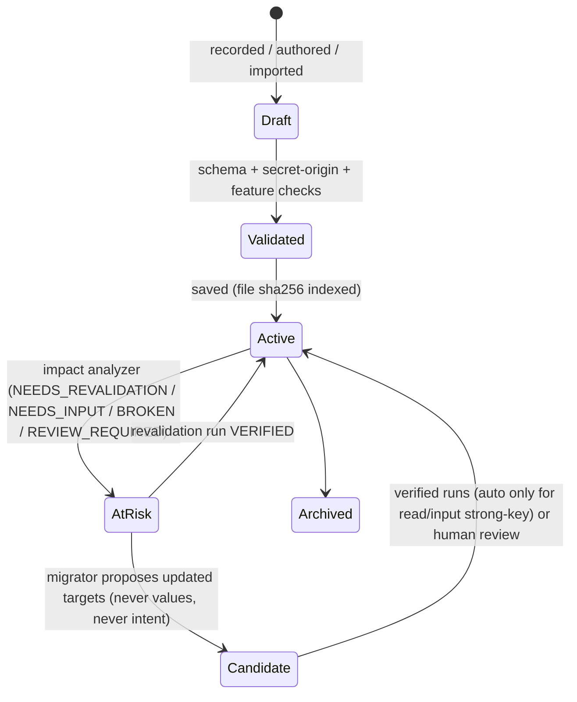
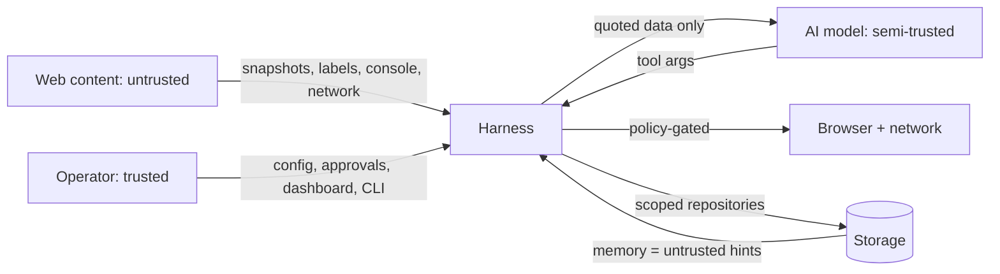

# 14 — Target V2 Architecture

## 1. Overview

```mermaid
flowchart TD
  subgraph Clients
    MCPC[MCP clients: Claude Code, Codex, Cursor, Kiro, Gemini CLI, VS Code]
    STUDIO[TG Studio / SDK consumers]
    OP[Operator: dashboard / CLI]
  end
  subgraph Transport["server/ (MCP only)"]
    STDIO[STDIO] --- HTTP[Streamable HTTP]
    REG[tool registry + profiles]
  end
  subgraph Harness["harness/ (no MCP imports)"]
    PIPE[ActionPipeline: per-page lock → resolve → policy gate → dispatch → settle → snapshot/diff → verify → observe]
    RES[TargetResolver + RefGuard + healer suggestions]
    VER[Verifier = AssertionEngine + network evidence]
    INS[PageInspector + FormInspector]
    ART[ArtifactService: paths, masking, retention]
  end
  subgraph Domain
    SNAP[snapshot/ engine (init-script install, fingerprints)]
    SESS[session/ registry + leases]
    ENF[security/ NetworkEnforcer + PolicyGate + redaction]
    WF[workflow/ executor + recorder + impact analyzer + migrator]
    MEM[memory/ scope, page identity, fingerprints, reconciler, service]
  end
  subgraph Storage["storage/ (repositories)"]
    REPO[Run · Workflow · Artifact · Memory repositories]
    SQL[(SQLite WAL via node:sqlite adapter)]
    FILES[(JSON workflows · binaries · JSONL journal/audit)]
    VAULT[(encrypted storage state + key / keychain)]
  end
  MCPC --> STDIO & HTTP --> REG --> PIPE
  STUDIO --> PIPE
  OP --> REPO
  PIPE --> RES --> SNAP
  PIPE --> ENF
  PIPE --> VER
  PIPE --> MEM
  PIPE --> ART
  WF --> PIPE
  WF --> REPO
  MEM --> REPO
  ART --> REPO
  SESS --> VAULT
  REPO --> SQL & FILES
```

## 2. Module responsibilities

| Module                                                | Responsibility                                                                                                                                                               | Built from                                  |
| ----------------------------------------------------- | ---------------------------------------------------------------------------------------------------------------------------------------------------------------------------- | ------------------------------------------- |
| `harness/action-pipeline.ts`                          | the only path for mutating actions: lock, resolution, policy, dispatch with bounded timeouts, settle, snapshot/diff, verification, memory observation, events, audit context | `ActionExecutor.run/finish`                 |
| `harness/target.ts` + `snapshot/element-reference.ts` | targets incl. `within`, ref guard, resolution policy (doc 03 §5.2), healer suggestions                                                                                       | existing                                    |
| `harness/verifier.ts`                                 | `ActionOutcome` computation (doc 04)                                                                                                                                         | `AssertionEngine`, `NetworkMonitor`         |
| `harness/inspectors.ts`                               | text/attributes/aria/element/perf; `form_inspect`                                                                                                                            | executor inspection methods                 |
| `harness/artifact-service.ts`                         | write roots, extension allowlist, masking, registration in `ArtifactRepository`                                                                                              | executor screenshot/trace + `writeArtifact` |
| `security/policy-gate.ts`                             | destructive/high-impact classification for every mutating action; approvals                                                                                                  | `PermissionManager`                         |
| `security/network-enforcer.ts`                        | context routes, redirect and committed URL checks, WS, loopback-origin rule                                                                                                  | `SessionManager.installPolicy` & listeners  |
| `session/`                                            | registry, leases (owner = run id / interactive / SDK caller), crash → degraded state                                                                                         | `SessionManager`                            |
| `memory/`                                             | doc 06/07                                                                                                                                                                    | new                                         |
| `workflow/`                                           | executor (v1+v2), recorder (container-scoped locators), impact analyzer, migrator (candidate versions)                                                                       | existing + new                              |
| `storage/`                                            | repositories, SQLite adapter, migrations, file atomic writes                                                                                                                 | new                                         |
| `server/`, `tools/`                                   | thin adapters; +`browser_form_inspect`, +`expect`/`within` params, memory summary option                                                                                     | existing                                    |
| `ui/`                                                 | read models from repositories; Memory Explorer (read-only)                                                                                                                   | existing                                    |

## 3. Storage model

See doc 05: SQLite for runs, memory, artifacts index, derived workflow index; JSON files for workflow definitions (V2.0) and import/export; filesystem for binaries; encrypted vault for auth state; JSONL for journal/audit.

## 4. Lifecycles

Memory lifecycle: doc 06 §4. Workflow lifecycle (V2):



## 5. Security boundaries



Rules: the model can never widen policy, approve, write memory directly, or read secrets; memory and imported workflows are untrusted inputs; approvals are per execution; every mutating path passes the policy gate.

## 6. Concurrency and reliability design (Phase 12)

| Concern                                 | Design                                                                                                                                                                                               |
| --------------------------------------- | ---------------------------------------------------------------------------------------------------------------------------------------------------------------------------------------------------- |
| Per-page serialization                  | async mutex per `PageState`; actions, snapshots and ref allocation acquire it; a timed-out action keeps the lock until the Playwright promise settles → others get `PAGE_BUSY` (bounded wait option) |
| Per-session leases                      | interactive (default), `run:<id>`, `sdk:<caller>`; workflows create own sessions by default                                                                                                          |
| Multiple MCP processes on one `dataDir` | SQLite WAL + `busy_timeout`; file workflow saves with optimistic `expectedSha`; Chromium profile lock surfaced as `PROFILE_IN_USE`                                                                   |
| Same workflow saved by two processes    | `expectedSha` mismatch → `CONFLICT`, no silent overwrite                                                                                                                                             |
| Concurrent memory updates               | unique constraints + `INSERT … ON CONFLICT` upserts; observations counter incremented atomically                                                                                                     |
| Browser crash during action             | page `crash` → session `degraded`, pending action → `INDETERMINATE`, page removed from registry; next action opens a new page and reports it                                                         |
| MCP client disconnect                   | STDIO: process shutdown closes browser (existing); HTTP: transport close → harness close only if no running workflow with `detached: true`                                                           |
| Process exit during transaction         | SQLite atomicity; runs left `running` are marked `interrupted` on next start (owner process id no longer alive)                                                                                      |
| Workflow cancelled                      | abort between steps; in-flight step recorded `cancelled` with dispatch `unknown`                                                                                                                     |
| Cloudflare container idle stop          | document as state loss; `/healthz` + run state in memory only; no promises of persistence                                                                                                            |
| Cleanup                                 | idle reaper never evicts sessions with in-flight requests or leases; `lastSeen` updated on request completion                                                                                        |

Identities kept distinct: transport session id, browser session id, page id, run id, (AI conversation not modelled).

## 7. Dashboard V2 (Phase 13)

| Feature                                                | V2.0                                                              | Later              | Reason                                                                                 |
| ------------------------------------------------------ | ----------------------------------------------------------------- | ------------------ | -------------------------------------------------------------------------------------- |
| Execution timeline (existing sessions view)            | keep                                                              |                    |                                                                                        |
| Workflow list/steps/run history (existing)             | keep + verification status column                                 |                    |                                                                                        |
| Memory Explorer (scopes → pages → versions → elements) | **read-only**                                                     | edit/purge actions | needed to trust memory                                                                 |
| Page version comparison (v3 ↔ v4 classifications)      | **yes**                                                           |                    | core of adaptive feature                                                               |
| Workflow impact view (states per workflow)             | **yes**                                                           |                    |                                                                                        |
| Approval queue                                         | no                                                                | maybe              | approvals happen in the MCP client (elicitation); a second channel adds attack surface |
| Healing history                                        | via memory events list                                            | dedicated view     |                                                                                        |
| Workflow editor                                        | no                                                                | later              | JSON in Git is the editor in V2.0                                                      |
| Element inspector / page inspector live                | no                                                                | later              | requires live browser access from dashboard — security review needed                   |
| Token analytics                                        | basic counters from audit (`durationMs`, response size if logged) |                    |                                                                                        |
| Security audit view                                    | list audit entries with filters                                   |                    |                                                                                        |
| Browser session management (kill/close)                | no                                                                | later              | dashboard must stay offline/read-mostly                                                |

Keep the current vanilla-JS dashboard and refactor incrementally (split `app.js` by view). Migrating to Angular is not justified by the V2 feature set; reconsider only if the editor and live inspectors are funded. The dashboard must never expose raw secrets, storage state, or memory text without quoting/escaping (current `clean()` + text rendering approach stays).

## 8. Application knowledge graph (Phase 14)

Relational tables suffice: Application→Page (`pages.scope_id`), Page→Variant (`page_versions.variant_key`), Page→Element, Workflow→Page/Element (`workflow_dependencies`), Page→Navigation destination (add `page_transitions(from_page, to_page, via_element, count)` when navigation discovery is funded), Element→Action→Outcome (`element_observations.verified_at` + run steps). Recursive CTEs handle workflow→workflow and reachability queries at this scale. **Reject** Neo4j, vector databases and embeddings for V2: no requirement demands similarity search or graph-scale traversal. Practical use cases supported by the tables: impact analysis (V2.0), regression planning ("which workflows touch pages changed this week") (V2.1), reuse of verified sequences / common fragments (later).

## 9. TG Studio integration (Phase 15)

Keep TG Browser MCP independent; integration through the SDK and events:

| Need                      | Current               | Enhancement                                                                                         |
| ------------------------- | --------------------- | --------------------------------------------------------------------------------------------------- |
| Agent-scoped sessions     | `agentId` on sessions | include `agentId` and `project` in all event payloads; leases per agent                             |
| Project-scoped memory     | n/a                   | `scope` passed at harness construction (`project`, `environment`) — not from model args             |
| Task delegation           | SDK calls             | expose `ActionPipeline` results (`ActionOutcome`) in SDK types                                      |
| Shared workflow libraries | files per project     | repository interface allows a Studio-provided implementation                                        |
| Lifecycle events          | 20 typed events       | add `action.verified`, `memory.version.created`, `workflow.impact` events; version the event schema |
| Authorization boundaries  | approval handler hook | add a policy hook (`beforeAction(ctx) → allow/deny/ask`) so Studio can enforce agent permissions    |
| Facade completeness       | partial               | `HarnessSession` gains scroll, drag, upload, tabs, frames, network, form inspect, verification      |

MCP compatibility for all clients is preserved because V2 only adds optional parameters and one tool; no client-specific behaviour.
