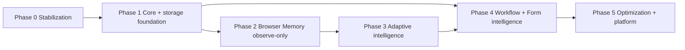
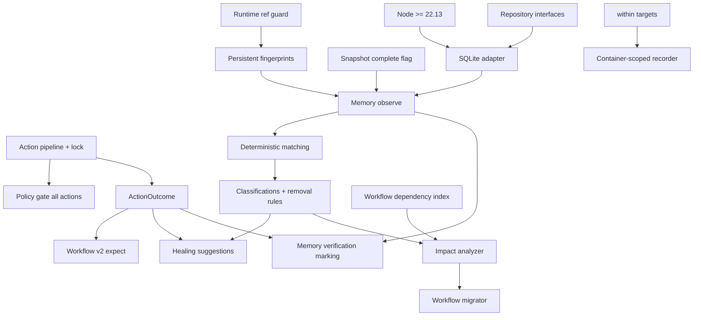

# 15 — Implementation Roadmap

## 1. Evaluation of the proposed roadmap

| Proposed item                      | Proposed tier | Classification                                                                      | Reasoning                                                                                   | New tier                                         |
| ---------------------------------- | ------------- | ----------------------------------------------------------------------------------- | ------------------------------------------------------------------------------------------- | ------------------------------------------------ |
| Full integration test verification | P0            | **ENHANCE**                                                                         | 125/128 pass; fix hermeticity, ffmpeg skip, add Docker build + D1–D10 regressions           | Phase 0                                          |
| Security hardening                 | P0            | **IMPLEMENT** (specific fixes)                                                      | S-01…S-08 are real bypasses                                                                 | Phase 0                                          |
| Element Fingerprint                | P0            | **IMPLEMENT (runtime guard only)**; persistent fingerprint → Phase 2                | fixes D1 cheaply; persistence only needed by memory                                         | Phase 0 (guard), Phase 2 (persistent)            |
| Action Verification                | P0            | **ENHANCE** existing AssertionEngine/NetworkMonitor                                 | contract + verifier, no new engine                                                          | Phase 1                                          |
| Storage Abstraction                | P0            | **IMPLEMENT** (repository interfaces + atomic file writes)                          | prerequisite, low risk                                                                      | Phase 0/1                                        |
| SQLite Storage                     | P0            | **IMPLEMENT, but later**                                                            | justified with memory/run indexing; requires Node ≥ 22.13                                   | Phase 1                                          |
| JSON Migration                     | P0            | **IMPLEMENT (runs only in V2.0)**                                                   | workflow definitions stay files until versioning                                            | Phase 1                                          |
| Basic Browser Memory               | P0            | **IMPLEMENT (observe-only, opt-in)**                                                | depends on storage + fingerprint + complete-snapshot flag                                   | Phase 2                                          |
| Page Fingerprint                   | P1            | **IMPLEMENT**                                                                       | shape/label hashes                                                                          | Phase 2                                          |
| Adaptive Memory                    | P1            | **IMPLEMENT (classification + candidate versions)**                                 |                                                                                             | Phase 3                                          |
| Memory Versioning                  | P1            | **MERGE_WITH_EXISTING** (= `page_versions` from Phase 2)                            | not a separate feature                                                                      | Phase 2                                          |
| Element Matching                   | P1            | **IMPLEMENT deterministic passes**                                                  |                                                                                             | Phase 3                                          |
| Confidence Engine                  | P1            | **REJECT as an acceptance mechanism; DEFER as display ordering**                    | thresholds are not proof; hard rules + uniqueness decide                                    | —                                                |
| Self-Healing                       | P1            | **IMPLEMENT suggest-mode only**; auto only for read/input strong-key                | safety                                                                                      | Phase 3                                          |
| Smart Form Engine                  | P1            | **ENHANCE `browser_fill` + 1 tool `form_inspect`**                                  | cheap, immediate value                                                                      | Phase 1 (fill fixes), Phase 4 (inspect + schema) |
| Workflow Engine V2                 | P1            | **ENHANCE** (v2 schema, expect, within, secrets origins, leases)                    | v1 compatible                                                                               | Phase 4 (fixes in Phase 0)                       |
| Workflow Impact Analyzer           | P1            | **IMPLEMENT**                                                                       | main business value of memory                                                               | Phase 3                                          |
| Batch Execution                    | P1            | **MERGE_WITH_EXISTING** (`fill fields`, workflows)                                  | a generic batch tool hides state                                                            | —                                                |
| Token Optimization V2              | P1            | **DEFER until benchmark exists**; `core` profile now                                | measurement first                                                                           | Phase 5 (core profile Phase 1)                   |
| Dashboard V2                       | P2            | **ENHANCE incrementally** (memory explorer read-only, version compare, impact view) |                                                                                             | Phase 3–5                                        |
| Visual Recognition                 | P2            | **REJECT for V2**                                                                   | no demonstrated need; adds models/heavy deps; accessibility-first is the product's strength | —                                                |
| Application Knowledge Graph        | P2            | **DEFER**; relational tables cover V2 use cases                                     |                                                                                             | after V2                                         |
| Regression Planning                | P2            | **DEFER** (query on impact data)                                                    |                                                                                             | after V2                                         |
| TG Studio Integration              | P2            | **ENHANCE SDK/events/policy hook**                                                  | keep decoupled                                                                              | Phase 5                                          |
| Secure Cloud Scaling               | P2            | **DEFER**; fix Docker first, document single-tenant                                 | no multi-tenant design yet                                                                  | Phase 0 (Docker), later (scaling)                |

## 2. Phased plan (adjusted to evidence)

### Phase 0 — Stabilization (no new features)

D11 Docker build; S-01 policy gate on all mutating paths; S-02 engine install hardening; S-03 generator; S-04 DNS metadata; S-05 secret origins (minimum: forbid secrets in URLs/inline workflows); S-06/D12 honest timeouts; S-07 assertion masking; S-08 write roots; D1 runtime ref guard; D10 slot duplication; D8 SDK project; D9 atomic writes + resilient `listRuns`; D13 retry class; D15 per-page lock; test hermeticity; doc corrections (SECURITY.md, ANGULAR.md, PROGRESS.md). Exit: all regressions green on 3 OSes; Docker image builds and passes `doctor` in CI.

### Phase 1 — Core and storage foundation

Action pipeline extraction; `ActionOutcome` + `expect` (doc 04); repository interfaces; Node ≥ 22.13 + `node:sqlite` adapter; SQLite runs/artifacts + JSON run migration; `fill` improvements (partial results, pre-checks, autocomplete, ambiguity); `within` targets + container-scoped recorder locators; session leases; `core` tool profile; snapshot `complete` flag.

### Phase 2 — Browser Memory (observe-only, opt-in)

Scope model; page identity; persistent fingerprints; page versions (observed/verified/active); verification marking from outcomes; memory summary line; derived workflow dependency index; Memory Explorer read-only; poisoning controls.

### Phase 3 — Adaptive intelligence

Deterministic matching passes; classifications with removal conditions; candidate versions + activation rules; impact analyzer; healing suggestions (suggest-mode) + limited auto-use; calibration benchmark in CI; version comparison + impact views in dashboard.

### Phase 4 — Workflow and form intelligence

Workflow schema v2 (expect, pre, page identity, semantic + fallback targets, recovery, secrets origins); resume from run; migrator producing candidate workflow versions; `browser_form_inspect`; real-framework fixtures (Material-like, PrimeNG-like) and adapters only where generic fails; optional move of workflow definitions to SQLite versions (V2.1).

### Phase 5 — Optimization and platform integration

V2 token benchmark (cold/warm/changed/replay) and decisions on memory-aware snapshot output; `snapshot:auto`; TG Studio policy hook + richer events; OS keychain; Firefox/WebKit CI; Cloudflare re-validation.

## 3. Dependencies

## 4. MVP definition (smallest V2 that delivers meaningful value)

**"Safe, verified, change-aware automation"**:

1. Phase 0 complete (no known target-confusion, approval-bypass, injection or SSRF-bypass defects; Docker builds).
2. `ActionOutcome` with `expect` on click/fill/press/select and workflow steps; honest timeouts; non-idempotent never retried.
3. `within`-scoped targets, ref guard, container-scoped recorder and generator.
4. SQLite-backed run history (migrated), repositories, atomic file writes.
5. Opt-in observe-only memory with page versions and a **change report + workflow impact analysis** (COMPATIBLE / NEEDS_REVALIDATION / NEEDS_INPUT / BROKEN / REVIEW_REQUIRED / UNKNOWN), visible in tool output and dashboard (read-only).

Explicitly out of the MVP: automatic healing of non-read steps, confidence scoring, workflow auto-migration, visual recognition, knowledge graph, dynamic tool discovery, Angular dashboard, multi-tenant cloud.
